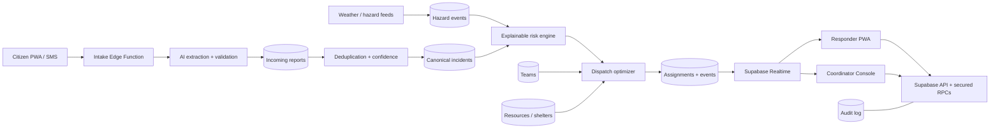

# ResQNet Hackathon Strategy and Build Plan

## 1. Executive summary

**Challenge:** Disaster response teams must identify who needs help most and coordinate limited people, vehicles, shelters, and supplies under incomplete information, competing priorities, and unreliable connectivity.

**Product:** ResQNet is an explainable, offline-capable disaster intelligence and dispatch platform. It converts fragmented citizen and field reports into verified incidents, calculates urgency and uncertainty, recommends the best response team and resources, and gives coordinators a live operational picture.

**Winning one-line pitch:**

> ResQNet finds the people most at risk, explains why they should be helped first, and coordinates the fastest feasible response—even when reports are incomplete or connectivity fails.

The project should not become a generic emergency dashboard. Every major feature should answer one of these questions:

1. Who is most at risk?
2. Who should receive help first, and why?
3. Which available team and resources can reach them fastest?
4. How can responders act before conditions become critical?
5. Can the system continue operating during degraded connectivity?

---

## 2. Current project status

### What is already working

| Area | Current implementation | Status |
|---|---|---|
| Repository | Separate `frontend/` and `backend/` applications | Complete |
| Frontend | React, TypeScript, Vite, Tailwind | Working |
| Data layer | Supabase JavaScript client and React Query hooks | Working |
| Database | Hosted Supabase PostgreSQL/PostGIS | Working |
| Incident intake | Public structured reporting with map location | Working |
| Tracking | Public report-code lookup | Working |
| Incident operations | List, filter, detail, update, and status workflow | Working |
| Priority engine | Deterministic PostgreSQL scoring with reasons | Working baseline |
| Teams | Team directory, capabilities, availability, and location | Working |
| Resources | Inventory and shelter/resource records | Working |
| Dispatch | Team recommendation by capability and distance | Working baseline |
| Assignment | Transactional assign/cancel flow with resource reservation | Working |
| Alerts | Escalation and assignment alerts with acknowledgement | Working |
| Auditability | Audit log and priority-escalation history | Working |
| Realtime | Subscriptions for incidents, teams, resources, assignments, alerts, and escalations | Working |
| Map | Incidents, teams, resources, and location picker | Working |
| Text extraction | Supabase Edge Function extracts structured report fields | Working, keyword-based |
| Demo data | Seed incidents, teams, resources, and assignments | Working |
| Code health | Type-check, ESLint, and production build | Passing on 17 Oct 2026 |

The deployed demo database was last verified with 18 incidents, 6 rescue teams, 7 resources, and 2 assignments.

### What is not genuinely complete yet

| Gap | Current reality | Priority |
|---|---|---|
| Authentication | Coordinator pages are public | P0 |
| Authorization | Current RLS policies allow anonymous CRUD on all operational tables | P0 |
| Credentials | Keys/tokens shared during setup must be rotated before judging or deployment | P0 |
| Dashboard truthfulness | Evacuation count, advisory, timestamp, some totals, and labels are hard-coded | P0 |
| Real AI | `ai-extract` is deterministic keyword matching, not an LLM or multimodal model | P0/P1 |
| Verification | No duplicate fusion, confidence model, evidence review, or trusted-source workflow | P0 |
| Dispatch optimization | Ranking uses capability count and straight-line distance; it does not optimize ETA, capacity, fairness, or multiple incidents | P1 |
| Offline operation | No installable PWA, local outbox, background synchronization, or conflict handling | P1 |
| Team field workflow | No responder mobile mode, live check-in, arrival, completion, or location updates | P1 |
| Early warning | No live weather, flood, fire, or hazard feed | P1 |
| Notifications | No SMS, push, WhatsApp, or voice notification delivery | P1/P2 |
| Testing | No automated unit, database, integration, or end-to-end tests | P1 |
| Observability | No error tracking, function monitoring, or operational health view | P1 |
| Performance | Production bundle is about 747 kB minified and needs route/code splitting | P2 |

### Honest readiness assessment

The product is a strong functional prototype, not an empty backend. Its foundation is approximately **55–60% of a compelling hackathon demo**. The CRUD and coordination skeleton exists. The work that creates a winning story is intelligence, verification, offline resilience, real data, secure roles, and a polished end-to-end demo.

---

## 3. The target product

ResQNet should support four connected experiences:

### A. Citizen reporting

- Report by text, voice, photo, or a very low-bandwidth form.
- Automatically capture GPS while allowing a landmark or manual pin.
- Work offline and submit when connectivity returns.
- Return a short report code for status tracking.
- Show nearby shelters and safety instructions after submission.
- Support multiple languages and accessible voice-first reporting.

### B. Intelligence and verification

- Convert unstructured reports into structured incident fields.
- Identify possible duplicate reports and merge them into one incident cluster.
- Attach evidence and preserve each original source.
- Calculate a confidence score based on source, recency, corroboration, location, and completeness.
- Calculate an explainable risk score and show the exact reasons and missing facts.
- Ask the reporter targeted follow-up questions for the uncertainty that matters most.
- Escalate automatically when risk, corroboration, or hazard conditions worsen.

### C. Coordinator command center

- Display a live map and priority queue.
- Show why each incident is prioritized and how confident the system is.
- Recommend teams and resources with an ETA and constraint explanation.
- Allow a human coordinator to approve or override a recommendation with a reason.
- Track dispatch, acknowledgement, en route, on scene, resolved, and cancelled states.
- Show resource shortages, shelter capacity, coverage gaps, and unresolved critical incidents.
- Produce an automatically generated situation report for briefings.

### D. Responder field mode

- Mobile-first assignment card with incident facts, route, contact, risks, and required equipment.
- Accept or reject an assignment with a reason.
- One-tap status updates: en route, arrived, needs backup, victim reached, completed.
- Periodic GPS updates where permission is granted.
- Offline access to assigned incident details and queued field updates.
- Upload evidence and a concise completion report.

---

## 4. Features that can win the hackathon

### P0 — Must ship for a credible demo

#### 4.1 Secure roles and permissions

Add Supabase Auth and three roles:

- `public`: create a report and retrieve only that report with a secure tracking token.
- `responder`: view assigned incidents and update their own team/assignment state.
- `coordinator`: manage incidents, teams, inventory, assignments, alerts, and reports.

Replace permissive RLS with role- and ownership-based policies. All sensitive operations should execute through secured database functions or Edge Functions.

**Why judges care:** It proves this is an operational system rather than a public CRUD demo.

#### 4.2 Explainable risk and uncertainty engine

Create two separate scores:

- **Risk score (0–100):** immediate threat to life, injuries, vulnerability, people affected, hazard growth, isolation, time waiting, and hazard-zone exposure.
- **Confidence score (0–100):** source reliability, report completeness, evidence, recency, location precision, and corroborating reports.

Never allow low confidence to mean low risk. A high-risk/low-confidence report should be marked **urgent verification**, not pushed down the queue.

Show:

- score breakdown;
- known facts;
- unknown critical facts;
- reason for last score change;
- human override and its audit trail.

**Winning detail:** Include a “What changed?” comparison whenever an incident moves priority.

#### 4.3 Duplicate detection and report fusion

Store individual incoming reports separately from canonical incidents. Detect duplicates using:

- geographic distance;
- time window;
- incident type;
- text similarity;
- shared phone/contact evidence;
- image similarity as a stretch goal.

Let a coordinator merge or split reports. Corroborating sources should increase confidence without inflating the number of affected incidents.

**Why judges care:** This directly solves duplicated and misleading information from the brief.

#### 4.4 Real AI-assisted intake

Upgrade the extractor to process text and voice transcripts, while keeping deterministic fallback behavior. It should return validated structured JSON:

- incident type;
- people affected/trapped;
- injuries and vulnerable people;
- hazard trend;
- location clues;
- immediate needs;
- uncertainty list;
- suggested follow-up questions.

AI must never directly dispatch a team. It proposes structured facts; deterministic rules and a human make consequential decisions.

**Demo moment:** Speak a chaotic emergency report and show the form fill itself, highlight uncertainty, and ask one useful follow-up question.

#### 4.5 Replace fake “live” data

Every number labeled live must be calculated from the database or a clearly labeled simulated feed. Replace the hard-coded:

- evacuation counts;
- fixed timestamp and “last synced” value;
- flood advisory;
- map totals;
- team/resource summary values;
- fallback shelter numbers.

Add a visible `DEMO SCENARIO` badge when using seeded or simulated information.

#### 4.6 End-to-end dispatch lifecycle

Implement this explicit state machine:

```text
reported -> triaged -> verified -> assigned -> dispatched -> on_scene -> resolved
                         |              |             |
                         +-> rejected   +-> cancelled +-> needs_backup
```

Every transition must validate permissions, write an audit entry, timestamp the event, and update related team/resource availability atomically.

---

### P1 — Differentiators that create the winning story

#### 4.7 Constraint-aware dispatch optimizer

Score candidate response plans using:

- capability match;
- travel ETA rather than straight-line distance;
- team status and capacity;
- required equipment and available inventory;
- incident risk and wait time;
- responder safety and blocked areas;
- preservation of geographic coverage;
- fairness so low-connectivity neighborhoods are not systematically deprioritized.

For multiple critical incidents, recommend a complete allocation plan instead of greedily assigning one team at a time. A Python optimization service using OR-Tools is justified here if the team has time; otherwise implement a deterministic PostgreSQL/TypeScript heuristic and display its explanation.

**Demo moment:** Close a road or make a team unavailable and show the plan recalculate with a reason.

#### 4.8 Offline-first PWA and low-bandwidth mode

- Installable PWA.
- Cache the application shell and the responder's active assignment.
- Save unsent public reports and field updates in IndexedDB.
- Display connectivity and synchronization status clearly.
- Retry with idempotency keys when online.
- Resolve update conflicts without losing the original event.
- Provide a text-only low-bandwidth view.

Optional fallback: accept an SMS report through a webhook and pass it through the same intake pipeline.

**Why judges care:** Connectivity failure is explicitly named in the challenge.

#### 4.9 Live responder tracking and ETA

- Responder consent and location-sharing controls.
- Throttled team-location updates.
- ETA and last-update age.
- Stale-location warning.
- “Needs backup” alert with responder position.
- Geofence-driven arrival suggestion, confirmed by the responder.

#### 4.10 Early-warning risk layers

Ingest one or two reliable feeds appropriate to the demo scenario, for example weather alerts and flood/water-level data. Normalize external events into a `hazard_events` table and display:

- active warning polygons;
- incidents inside or approaching danger zones;
- forecast severity and expiry;
- source and last-updated time;
- automatic risk recomputation with an explanation.

Keep this focused. One real, reliable integration is stronger than five brittle integrations.

#### 4.11 Resource and shelter intelligence

- Resource quantities, units, expiry, condition, and location.
- Reservation and consumption ledger instead of only counters.
- Shelter capacity, occupancy, accessibility, medical support, pets, and power status.
- Low-stock and predicted-shortage alerts.
- Suggest the nearest suitable shelter, not simply the nearest shelter.
- Show where moving one team or resource would create a coverage gap.

#### 4.12 Automated situation report

Generate a reviewable operational summary containing:

- incident totals and changes;
- critical unresolved incidents;
- deployed and available teams;
- shelter and inventory pressure;
- active warnings;
- notable escalations and decisions;
- data confidence and last synchronization time.

Allow PDF/print export, but clearly identify generated text and require coordinator approval.

---

### P2 — Stretch features

- Multilingual voice reporting and read-aloud safety instructions.
- Image-assisted damage assessment with explicit confidence and human review.
- Family reunification or “I am safe” registry with strict privacy controls.
- Evacuation routing that accounts for road closures and accessibility.
- Incident heat maps and demand forecasting.
- Inter-agency mutual-aid requests.
- Signed, tamper-evident audit exports.
- Public transparency view using aggregated, privacy-safe data.
- Post-incident analytics: response time, verification time, false duplicate rate, resource utilization, and underserved-area analysis.

These should not displace P0 work.

---

## 5. Recommended architecture



### Technology decisions

- Keep Supabase/PostgreSQL/PostGIS as the system of record.
- Keep transactional state changes in PostgreSQL functions.
- Use Supabase Edge Functions for protected integrations, AI calls, notifications, and webhooks.
- Add Python/FastAPI only for a real need such as multi-incident optimization or computer vision.
- Never place a service-role key or third-party secret in the frontend.
- Make every external integration optional with a deterministic demo fallback.

---

## 6. Required data model changes

Add these tables or equivalent structures:

| Table | Purpose |
|---|---|
| `profiles` | User identity, role, organization, and status |
| `organizations` | Agencies and operational boundaries |
| `incoming_reports` | Immutable raw reports from web, voice, SMS, field, or external feeds |
| `report_evidence` | Images, audio, documents, metadata, and hashes |
| `incident_report_links` | Many reports linked to one canonical incident with match score |
| `incident_score_events` | Risk/confidence breakdown and reason for every recalculation |
| `incident_status_events` | Append-only state transition history |
| `assignment_events` | Accept, dispatch, arrival, backup, completion, and cancellation events |
| `team_location_events` | Time-series responder/team locations with retention controls |
| `resource_ledger` | Reservation, release, consumption, transfer, and adjustment history |
| `shelters` | Capacity and suitability attributes separate from generic resources |
| `hazard_events` | Normalized warnings, geometry, severity, source, and expiry |
| `notifications` | Delivery channel, recipient, state, retries, and idempotency key |
| `sync_operations` | Offline mutation IDs and conflict/idempotency handling |
| `model_runs` | AI/optimization input hash, version, output, confidence, and review status |

Important schema rules:

- Raw reports and event history should be append-only.
- Store structured score factors, not only a final number.
- Use idempotency keys for public submissions, notifications, and offline synchronization.
- Put retention limits on precise location and sensitive evidence.
- Store timestamps in UTC and render them in the user's timezone.

---

## 7. Backend functions and endpoints to build

### Database functions

- `submit_report(...)`
- `calculate_risk_and_confidence(incident_id)`
- `find_duplicate_candidates(report_id)`
- `merge_report_into_incident(report_id, incident_id, actor_id)`
- `transition_incident(incident_id, next_status, reason)`
- `recommend_response_plan(incident_id)`
- `assign_response_plan(...)`
- `record_assignment_event(...)`
- `record_resource_movement(...)`
- `generate_operations_summary(...)`

### Edge Functions

- `intake-report`: validate, rate-limit, redact, store, and enqueue processing.
- `extract-report`: structured extraction from text/transcript with schema validation.
- `transcribe-report`: voice-to-text, if voice reporting is included.
- `ingest-hazards`: scheduled external-feed ingestion.
- `notify`: SMS/push/email delivery with retries.
- `optimize-dispatch`: optional bridge to a Python optimizer.
- `generate-sitrep`: draft a grounded situation report from database facts.

All functions need structured errors, correlation IDs, authorization checks, rate limits, and audit entries.

---

## 8. Three-developer execution plan

Ownership should minimize blocking while ensuring one integrated flow.

### Developer 1 — Citizen/responder experience and offline UX

- PWA setup, application shell caching, offline indicator, and IndexedDB outbox.
- Voice/text incident intake and targeted AI follow-up UI.
- Report tracking and safety/shelter result screen.
- Responder assignment card and status actions.
- Accessibility, responsive behavior, loading/error states, and demo polish.

### Developer 2 — Supabase platform, security, and realtime operations

- Auth, profiles, roles, and strict RLS policies.
- New report/event/evidence/resource-ledger schema.
- Transactional RPCs and lifecycle state validation.
- Realtime subscriptions, notification records, auditability, and seed scenario.
- Database tests, migration safety, monitoring, and deployments.

### Developer 3 — Intelligence, maps, and decision support

- AI extraction contract and deterministic fallback.
- Duplicate detection, confidence model, and explainable risk scoring.
- Dispatch recommendations/optimizer and ETA integration.
- Hazard-feed ingestion and map risk layers.
- Situation-report generator and decision explanations.

### Shared responsibilities

- Define API contracts and TypeScript types before parallel implementation.
- Integrate to `main` at least twice per day.
- Maintain one deterministic seed/demo scenario.
- Pair-review security, scoring, and state-transition code.
- Rehearse the final demo together and keep a prerecorded backup.

---

## 9. Suggested 72-hour schedule

### Hours 0–6: freeze scope and contracts

- Agree on the single flood scenario and demo script.
- Rotate exposed credentials.
- Define roles, state machines, score factors, schemas, and request/response contracts.
- Create issues and assign ownership.
- Remove or label all fake live data.

### Hours 6–24: build the secure vertical slice

- Auth and RLS.
- Incoming report model and secure submission.
- Real extraction contract with fallback.
- Risk/confidence calculation and explanation.
- Coordinator verification and dispatch lifecycle.
- Responder accepts assignment and updates status.

**Checkpoint:** One report must travel from citizen submission to responder completion.

### Hours 24–44: add the differentiators

- Duplicate/corroboration workflow.
- Offline outbox and synchronization.
- Dispatch recommendation/optimization.
- One live hazard feed.
- Realtime alerts and team status.

### Hours 44–58: harden and test

- Unit tests for scoring and duplicate matching.
- Database tests for RLS and state transitions.
- End-to-end happy path and connectivity-loss path.
- Rate limiting, validation, error handling, and loading states.
- Fix code splitting and obvious accessibility issues.

### Hours 58–72: demo and presentation

- Final seed scenario and clean deployment.
- Situation report and metric cards.
- Record backup demo video.
- Rehearse a five-minute story repeatedly.
- Freeze features several hours before submission.

If the hackathon is shorter, preserve the order and cut P2 first, then the latter half of P1.

---

## 10. Recommended five-minute demo

### Scene 1 — Chaos becomes structured information

A citizen speaks: “Water is entering our home near the old bridge. My grandmother cannot walk, two children are upstairs, and the water is rising.”

ResQNet transcribes/extracts the report, places it on the map, identifies vulnerability and increasing danger, and asks the one missing high-value question: “Is anyone trapped or unable to exit?”

### Scene 2 — The system finds who needs help first

The coordinator sees the new incident become critical. The screen explains every risk factor, shows low/high-confidence facts, and links a second nearby report as corroboration rather than creating a duplicate.

### Scene 3 — Limited resources are allocated intelligently

ResQNet recommends a water-rescue team, accessible transport, and the nearest suitable shelter. It shows capability match, ETA, inventory impact, and why a closer team is not suitable.

### Scene 4 — Connectivity fails without losing the response

The responder accepts the assignment, loses connectivity, records arrival and a backup request offline, then reconnects. Queued events synchronize once, in order, with a visible audit trail.

### Scene 5 — The command picture updates

The coordinator receives the backup alert, the map and resource counts update in realtime, and ResQNet produces a factual situation report.

Close with measurable impact:

- reduced time from report to verified priority;
- reduced duplicate incidents;
- faster feasible dispatch;
- transparent prioritization;
- continued operation during network failure.

---

## 11. Quality and safety requirements

### Tests that must exist

- Risk score boundary and missing-information tests.
- High-risk/low-confidence reports never silently deprioritized.
- Duplicate matching false-positive and false-negative examples.
- RLS tests proving public users cannot access operational data.
- Assignment concurrency tests so one team cannot serve two active assignments.
- Inventory cannot fall below zero.
- State machine rejects invalid transitions.
- Offline retries do not create duplicate reports/events.
- AI output failing schema validation falls back safely.
- One end-to-end demo-path test.

### Responsible AI rules

- AI extracts and recommends; humans retain consequential control.
- Every recommendation includes reasons and uncertainty.
- Preserve source evidence and the unmodified original report.
- Record model/provider/version and review outcome.
- Never infer sensitive traits that were not reported.
- Do not let language quality, device quality, or source channel become a proxy for priority.
- Support an explicit override with a required reason and audit record.

### Operational safety

- Label simulated data clearly.
- Do not claim that map routes are safe without authoritative routing data.
- Display source and age for every hazard feed.
- Minimize personal data and restrict precise victim/responder locations.
- Add rate limits, CAPTCHA/abuse controls, and file scanning for public intake.

---

## 12. Success metrics

Use metrics in the demo and final presentation:

| Goal | Metric |
|---|---|
| Fast intake | Median time to submit or structure a report |
| Better prioritization | Time from report to verified priority |
| Information quality | Percentage of critical fields known and confidence trend |
| Duplicate control | Reports fused per canonical incident and merge precision |
| Response speed | Time from verified incident to accepted assignment |
| Allocation quality | Capability match, ETA, and resource feasibility |
| Resilience | Offline actions synchronized successfully without duplicates |
| Accountability | Percentage of priority/dispatch decisions with explanations and audit records |
| Fairness | Response-time comparison across locations, languages, and intake channels |

For the hackathon, these can be calculated from a seeded simulation as long as that is labeled clearly.

---

## 13. Scope cut line

### Demo cannot ship without

- secure coordinator/responder roles;
- honest live data;
- explainable risk plus uncertainty;
- report verification/duplicate handling;
- complete dispatch lifecycle;
- one offline flow;
- a deterministic, rehearsed scenario.

### Add only after the above works

- advanced multi-incident optimization;
- live hazard integration;
- voice and multilingual support;
- generated situation report;
- image analysis;
- multiple notification channels.

The strongest submission is a reliable end-to-end response story with two or three deep differentiators. A large collection of disconnected screens will be less convincing.

---

## 14. Immediate next actions

1. Rotate the exposed Supabase service-role key and personal access token.
2. Remove anonymous update/delete access and implement Auth plus strict RLS.
3. Convert the hard-coded dashboard values into database-derived or clearly simulated data.
4. Add `incoming_reports` and score-event history so verification and duplicate fusion are possible.
5. Finalize the risk/confidence formula and seed five test cases before coding the UI.
6. Implement one secure vertical flow: report -> extract -> verify -> prioritize -> recommend -> assign -> responder update -> resolve.
7. Add the offline outbox to that flow.
8. Only then add optimizer, hazard feed, voice, and situation-report polish.

